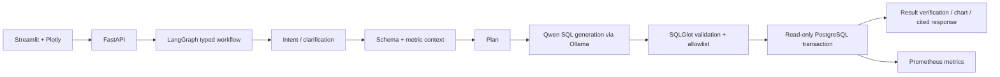

# Enterprise AI Data Analyst Agent

A portfolio-quality, local-first conversational analyst for PostgreSQL. It uses LangGraph for orchestration, Qwen2.5 Instruct through Ollama for inference, FastAPI for the API, Streamlit/Plotly for the UI, and PostgreSQL with a least-privilege reader account. No paid API or cloud inference is used.

## Quick start

Prerequisites: Docker Compose (with 8+ GB RAM recommended). Copy the environment defaults, then start and seed the stack:

```bash
cp .env.example .env
make up
make seed
# open http://localhost:8501
```

The initial model pull can take time. The default `qwen2.5:0.5b` is CPU-compatible; change `OLLAMA_MODEL` to a locally available Qwen2.5 model if desired. API docs are at `http://localhost:8000/docs`; Prometheus scrape metrics are at `http://localhost:8000/metrics`.

Useful lifecycle commands:

```bash
make test       # automated unit/security tests in the Python 3.11 image
make lint       # Ruff and mypy
make eval       # 100 reproducible questions, writes evaluation/results.json
make down       # stop and remove local containers/data
```

## Architecture



The workflow persists multi-turn context per API process and exposes inspected SQL, table results, downloadable CSV, and a query history endpoint. Production deployments should replace in-memory conversation history with an access-controlled persistent store.

## Dataset

`python -m database.seed --orders 50000` creates a fixed-seed synthetic e-commerce dataset: customers, products, orders, order items, returns, inventory, and payments. It contains 10,000 customers, 250 products, deterministic relationships, Q4 seasonality, promotion discounts, and category-sensitive return behavior. The command is repeatable.

## Evaluation

`evaluation/questions.py` contains exactly 100 fixed business-question cases and expected executable SQL. `make eval` executes the expected query and the complete local-agent run, then calculates answer/result correctness, SQL execution rate, average/p95 latency, token availability, and adversarial rejection rate. It does not ship fabricated benchmark numbers: `evaluation/results.json` only appears after an actual run.

## Project map

- `agents/`: LangGraph nodes, local Ollama client, business context.
- `backend/`: FastAPI service and SQL guardrail.
- `database/`: SQLAlchemy models, deterministic seed, database role bootstrap.
- `frontend/`: Streamlit dashboard.
- `evaluation/`: repeatable benchmark harness and 100 cases.
- `tests/`: unit and malicious-SQL coverage.
- `docs/`: operations and architectural notes.

See [SECURITY.md](SECURITY.md), [LICENSES.md](LICENSES.md), and [docs/OPERATIONS.md](docs/OPERATIONS.md).
The current validation status is recorded in [docs/VALIDATION.md](docs/VALIDATION.md).
